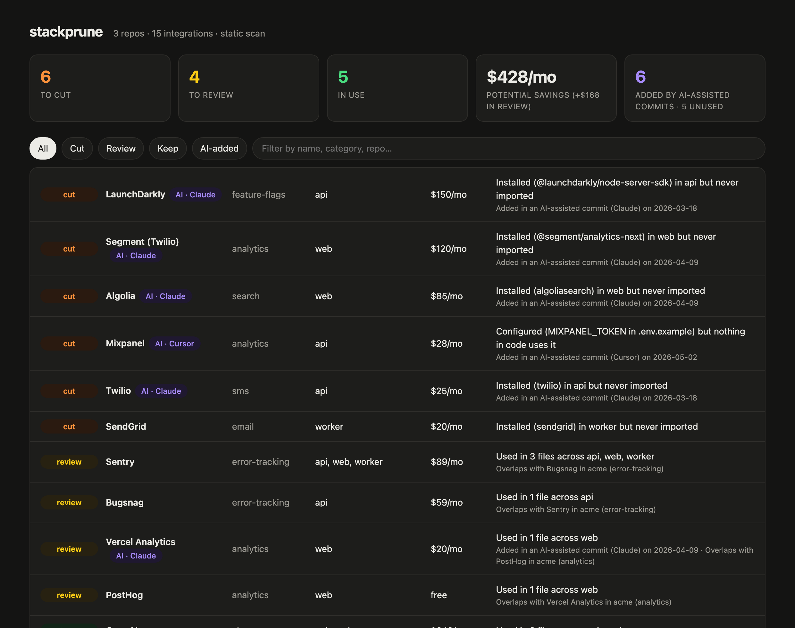

# stackprune

**Find the integrations you pay for but don't use.**

stackprune scans your repos for third-party services (Stripe, Sentry, Twilio, OpenAI, Segment, and 200+ more), shows how much each one is actually wired in, and tells you what to cut, what to look at, and what to keep.

```bash
npx stackprune ~/code/acme
```



## Why

Adding an integration is one `npm install` away, and with AI assistants it's one prompt away. Removing one never happens. Six months later you have:

- an SDK that was installed for a spike and never imported,
- API keys in `.env.example` for a vendor nobody calls,
- two error trackers, two analytics tools and three email providers doing the same job,
- and a monthly bill for all of them.

Your dependency tool sees packages. Your finance tool sees invoices. Nothing connects the two. stackprune reads the code, the env files and the git history, and optionally real runtime traffic, so you can answer "do we still need this?" with evidence.

## What you get

```
stackprune · 3 repos · 15 integrations
  6 cut   4 review   5 keep   │   potential savings $428/mo (+$168/mo under review)
  6 added in AI-assisted commits — 5 of them unused

✂ CUT — not used, safe to remove
  LaunchDarkly      feature-flags   api       $150/mo   Installed (@launchdarkly/node-server-sdk) in api but never imported
                                                        ↳ Added in an AI-assisted commit (Claude) on 2026-03-18
  Segment (Twilio)  analytics       web       $120/mo   Installed (@segment/analytics-next) in web but never imported
  Algolia           search          web       $85/mo    Installed (algoliasearch) in web but never imported
  Mixpanel          analytics       api       $28/mo    Configured (MIXPANEL_TOKEN in .env.example) but nothing in code uses it
                                                        ↳ Added in an AI-assisted commit (Cursor) on 2026-05-02
  Twilio            sms             api       $25/mo    Installed (twilio) in api but never imported
  SendGrid          email           worker    $20/mo    Installed (sendgrid) in worker but never imported

? REVIEW — used, but something looks off
  Sentry            error-tracking  api, web  $89/mo    Used in 3 files across api, web, worker
                                                        ↳ Overlaps with Bugsnag in acme (error-tracking)
  Bugsnag           error-tracking  api       $59/mo    Used in 1 file across api
  Vercel Analytics  analytics       web       $20/mo    Used in 1 file across web
                                                        ↳ Overlaps with PostHog in acme (analytics)

✓ KEEP — in use
  OpenAI            ai              api, worker  $640/mo  Used in 2 files across api, worker
  Stripe            payments        api, web     $420/mo  Used in 2 files across api, web
  ...
```

That output comes from a made-up company: run `pnpm build && pnpm demo` to reproduce it. Reports come as a terminal table, Markdown, JSON or a self-contained HTML page ([example](examples/demo-report.html)).

## How it decides

For every vendor it finds, stackprune collects evidence from each repo:

| Evidence | Where it looks |
|---|---|
| **Dependency** | `package.json`, `requirements*.txt`, `pyproject.toml`, `Pipfile`, `go.mod`, `Gemfile`, `composer.json`, `Cargo.toml`, `*.csproj` |
| **Import** | `import`/`require`/dynamic imports (JS/TS), `import`/`from` (Python), Go imports, Ruby `require`, Rust `use`, `boto3.client("s3")`, `new AWS.S3()`, packages wired up from scripts (`node -r dd-trace/init`) or config files (Expo/Next plugins) |
| **Env var** | `.env*` files, `docker-compose`, CI YAML (declared) vs. source code (read); only names are read, never values |
| **API host** | URLs and hostnames in code and config (`api.stripe.com`, `*.ingest.sentry.io`, `sqs.*.amazonaws.com`) |
| **Git** | When it was introduced, by whom, whether that commit credits an AI assistant (Claude, Copilot, Cursor, Codex, Aider, Devin, Gemini…), and when the code using it was last touched |
| **Runtime** *(optional)* | Real outbound calls per vendor, from the [runtime probe](#runtime-usage) or your own logs |

Then it gives each integration a verdict:

| Verdict | When |
|---|---|
| **cut** | Installed but never imported · or credentials configured that nothing in code reads |
| **review** | Overlaps with another vendor doing the same job in the same app · only read as env vars (could be a framework, could be dead config) · in code but **zero calls** in your runtime data |
| **keep** | Imported or called, no overlap, or marked `keep: true` in config |

It also flags leftovers ("Stripe is used in `api`, but still installed and unused in `admin`"), consolidation candidates across apps, and **unknown external domains**: URLs in your code that match no known vendor. Those are usually partner APIs and niche services you'll want to track too.

## Quick start

```bash
# one repo
npx stackprune .

# a folder full of repos: each repo becomes a target, grouped as one app
npx stackprune ~/code/acme

# several apps at once
npx stackprune ~/code/shop ~/code/backoffice ~/code/mobile

# shareable report
npx stackprune ~/code/acme --out stackprune-report.html
```

Then write a config with what it found and fill in costs and owners:

```bash
npx stackprune init ~/code/acme   # writes stackprune.yml
```

## Configuration

`stackprune.yml` (or `.stackprune.yml` / `stackprune.json`) in the current folder or the first scanned path:

```yaml
currency: EUR

integrations:
  stripe:   { owner: payments, purpose: Checkout and subscriptions, cost: 420 }
  sentry:   { owner: platform, cost: { monthly: 89, plan: Team } }
  twilio:   { cost: 25 }
  segment:  { keep: true, purpose: Contractually required export }   # never suggest cutting

# Integrations the catalog doesn't know: partner APIs, in-house services, niche vendors.
vendors:
  - id: parcelpartner
    name: ParcelPartner
    category: other
    hosts: ["*.parcelpartner.io"]
    env: ["PARCELPARTNER_*"]

ignore: [vercel]                         # vendor ids to leave out entirely
ignoreHosts: [acme.com, "*.acme.dev"]    # your own domains, hidden from "unknown domains"
exclude: [legacy/, scripts/fixtures]     # paths to skip (node_modules, dist, build… are skipped already)

check:
  requireOwner: true     # fail CI when a PR adds an integration nobody owns
  requirePurpose: false
```

## In CI: catch new integrations at the pull request

`stackprune check` compares a branch with its base and lists what the PR adds or removes. Nothing in the old code is flagged, and you get a nudge when a PR quietly adds a fourth email provider.

```yaml
# .github/workflows/stackprune.yml
name: stackprune
on: pull_request
permissions:
  contents: read
  pull-requests: write
jobs:
  check:
    runs-on: ubuntu-latest
    steps:
      - uses: actions/checkout@v4
        with: { fetch-depth: 0 }
      - uses: YlldritQ/stackprune@main
```

The action posts one PR comment and keeps it updated, writes the report to the job summary, and fails the job when `check.requireOwner` / `check.requirePurpose` are set and a new integration isn't claimed in `stackprune.yml`.

For a recurring audit, run a scan on a schedule and keep the HTML as an artifact:

```yaml
on:
  schedule: [{ cron: "0 7 * * 1" }]   # Mondays
jobs:
  audit:
    runs-on: ubuntu-latest
    steps:
      - uses: actions/checkout@v4
        with: { fetch-depth: 0 }
      - id: sp
        uses: YlldritQ/stackprune@main
        with: { command: scan }
      - uses: actions/upload-artifact@v4
        with: { name: stackprune-report, path: "${{ steps.sp.outputs.html }}" }
```

Locally, the same check works with `npx stackprune check --base origin/main`. It compares committed trees, so your local `.env` doesn't show up as "added".

## Runtime usage

Static analysis tells you an SDK is *wired in*. It can't tell you the code path still runs. For that, add the probe to a Node service:

```bash
npm i stackprune
node --import stackprune/register server.js
# or: NODE_OPTIONS="--import stackprune/register" npm start
```

It subscribes to Node's built-in `diagnostics_channel` events for `fetch`/undici and `http`/`https`, which covers axios, got, node-fetch and most vendor SDKs. There's no monkey-patching. Every minute it appends one line per vendor to `.stackprune/usage-<app>-<host>.jsonl`. It records **hostname, call count, error count and latency only**: no paths, query strings, headers or bodies. Localhost and private-network calls are ignored.

| Env var | Default | |
|---|---|---|
| `STACKPRUNE_APP` | npm package name | Use the repo name so usage lines up with the scan |
| `STACKPRUNE_OUT` | `.stackprune` | Folder for JSONL files (`""` disables) |
| `STACKPRUNE_ENDPOINT` | – | Also POST each batch here (for containers with no persistent disk) |
| `STACKPRUNE_FLUSH_MS` | `60000` | Flush interval |
| `STACKPRUNE_DISABLED` | – | `1` turns it off |

Feed the files back in:

```bash
npx stackprune ~/code/acme --usage ./usage-from-prod/
```

Integrations that are in code but got **zero calls** during the window become `review · dormant`, and hosts nobody cataloged show up with call counts.

**Not on Node?** The format is plain JSONL, so you can produce it from egress-proxy logs, an API gateway, or an OpenTelemetry exporter:

```json
{"ts":"2026-05-31T00:00:00Z","from":"2026-05-01T00:00:00Z","app":"worker","host":"api.openai.com","calls":18234,"errors":12}
```

`vendor` (a catalog id) is optional: it's derived from `host`.

## Use it as a library

```ts
import { scan } from 'stackprune';

const report = await scan({ paths: ['../api', '../web'], usage: ['./usage'] });
for (const i of report.integrations.filter((i) => i.verdict === 'cut')) {
  console.log(i.vendor.name, i.reasons[0]);
}
```

## Privacy

- Runs locally. The CLI makes no network requests.
- `.env` files are parsed for **variable names only**. Values are never read into the report.
- The runtime probe records hostnames and counters, nothing about request content.
- Reports contain repo-relative file paths, vendor names and your config. Review them before sharing outside your team.

## Supported

| | Dependencies | Imports | Env / hosts |
|---|---|---|---|
| JavaScript / TypeScript (npm, pnpm, yarn, bun) | ✅ | ✅ | ✅ |
| Python (pip, Poetry, uv, Pipenv) | ✅ | ✅ | ✅ |
| Go | ✅ | ✅ | ✅ |
| Ruby | ✅ | ✅ | ✅ |
| Rust | ✅ | ✅ | ✅ |
| PHP (Composer), .NET (NuGet) | ✅ | – *(assumed used)* | ✅ |
| Java / Kotlin / Swift / Dart | – | – | ✅ |

`npx stackprune catalog` lists all known vendors; `npx stackprune catalog analytics` filters them.

## Limitations

Honest list, so you know what a verdict means:

- **Static ≠ live.** "Imported" doesn't mean the code path runs. Add runtime data for that.
- **Browser and mobile SDKs** can't be probed from a Node server, so they're never marked dormant. Their evidence is static only.
- **Costs come from you.** stackprune doesn't read invoices (yet). Without costs you still get the cut/review/keep list, just no savings total.
- **Reflection and string-built imports** (`require(name)`) aren't followed. Neither are SDKs used only through a framework's config, which show up as "only read as env vars" and land in review, not cut.
- **The catalog is finite.** Unknown domains help, and `vendors:` in config fills the gap. PRs to the catalog are welcome.

## Contributing

The vendor catalog lives in [`src/catalog/vendors.ts`](src/catalog/vendors.ts). Adding a vendor is one object: id, name, category, packages per ecosystem, env var patterns, API hosts. Keep patterns specific: `STRIPE_*`, not `*_KEY`. The tests reject over-broad ones.

```bash
pnpm install
pnpm test
pnpm build && pnpm demo
```

## License

MIT
